<p align="center">
  
</p>

# 🚀 Awesome Distributed Training Tools

<p align="center">
  <strong>Curated ecosystem of Multi-GPU Orchestration, Zero-Boilerplate Launchers, Scaling Frameworks, and Experiment Trackers for Modern Deep Learning &amp; LLM Training.</strong>
</p>

<p align="center">
  <a href="https://github.com/ishandutta2007/Awesome-Awesome-Awesome"></a>
  <a href="https://discord.gg/jc4xtF58Ve"></a>
  <a href="https://github.com/ishandutta2007/Awesome-Distributed-Training-Tools/stargazers"></a>
  <a href="https://github.com/ishandutta2007/Awesome-Distributed-Training-Tools/network/members"></a>
  <a href="https://github.com/ishandutta2007/Awesome-Distributed-Training-Tools/pulls"></a>
  <a href="https://github.com/ishandutta2007/Awesome-Distributed-Training-Tools/blob/main/LICENSE"></a>
  <a href="https://github.com/ishandutta2007"></a>
</p>

---

## 📖 Overview

Training state-of-the-art foundation models and deep neural networks requires scaling workloads across hundreds or thousands of GPUs, TPUs, and compute nodes. This curated repository provides a comprehensive index of industry-leading **enterprise SaaS platforms** and **open-source frameworks** powering high-performance distributed AI computing—from memory-partitioning optimizers (ZeRO, FSDP) and ring-allreduce primitives to GPU cluster schedulers and telemetry suites.

---

## 📑 Table of Contents

- [📊 Sector Overview & Market Dynamics](#-sector-overview--market-dynamics)
- [🏢 SaaS & Hosted Platforms](#-saas--hosted-platforms)
- [🛠️ Open-Source GitHub Projects](#️-open-source-github-projects)
- [🧩 Architectural Comparison: Parallelism Strategies](#-architectural-comparison-parallelism-strategies)
- [🤝 How to Contribute](#-how-to-contribute)
- [⚖️ Disclaimer](#️-disclaimer)
- [📈 Star History](#-star-history)
- [📄 License](#-license)

---

## 📊 Sector Overview & Market Dynamics

The global distributed deep learning and AI compute infrastructure market was valued at approximately **$28.4 billion in 2024** and is projected to expand to **$115+ billion by 2030**, reflecting a blistering **CAGR of ~31%** fueled by hyperscale pretraining clusters, multi-modal reasoning models, and enterprise fine-tuning pipelines.

The industry exhibits a dual dynamic:
- **Hardware & Hyperscale Layer (Highly Concentrated / Winner-Take-Most):** Dominated almost exclusively by NVIDIA hardware/networking (InfiniBand, NVLink, DGX) and top-tier cloud providers (AWS, Azure, Google Cloud).
- **Orchestration, Tooling & Software Layer (Moderately Fragmented):** Richly distributed between modular open-source runtimes (Ray Train, PyTorch FSDP, DeepSpeed) and specialized commercial platforms (Weights & Biases, Domino Data Lab, Run:ai), allowing engineering teams to combine zero-boilerplate code launchers with dedicated telemetry and cluster virtualization fabrics.

---

## 🏢 SaaS & Hosted Platforms

A comparison of leading hosted enterprise platforms for AI workload scheduling, GPU cluster virtualization, and distributed experiment tracking. Sorted by **Company Scale (Valuation / Market Capitalization) descending**.

| 🏢 Platform / Provider | 📈 Company Scale (Valuation / Revenue) | 💵 Starting Pricing | 🎁 Free Tier / Free Trial Limits | 🎯 Key Capabilities & Best For |
| :--- | :--- | :--- | :--- | :--- |
| **[NVIDIA Base Command](https://www.nvidia.com/en-us/data-center/base-command/)** | **~$3,300 Billion** ($3.3T Market Cap) | **$4,500 / GPU / year** (via NVIDIA AI Enterprise) or **$19,600 / month** (DGX Cloud 8x H100 instance) | **Free-to-use perpetual license** for Base Command Manager for up to 8 accelerators per node (renewable annually, unlimited cluster size) | Enterprise cluster orchestration, bare-metal hardware telemetry, and multi-node DGX job scheduling. |
| **[CoreWeave](https://www.coreweave.com/)** | **~$19.0 Billion** (Valuation) | **$2.23 / GPU / hour** (NVIDIA H100 PCIe) / **$2.99 / GPU / hour** (H100 SXM5 80GB) | **14-day Enterprise pilot trial** with up to **$1,000 compute credits** upon sales approval | Specialized GPU cloud infrastructure with ultra-low latency InfiniBand interconnects for multi-node LLM training. |
| **[Weights & Biases](https://wandb.ai/)** | **~$1.25 Billion** (Valuation) | **$50 / user / month** (billed annually, Teams tier) | **Free forever plan**: 1 user, 100 GB artifact storage, 1 GB/month Weave LLM tracing, and unlimited public/personal projects | Industry-standard experiment tracking, distributed run metric telemetry, model registry, and hyperparameter sweeps. |
| **[Domino Data Lab](https://www.domino.ai/)** | **~$1.20 Billion** (Valuation) | **$50,000 / year** (~$4,166 / month) base enterprise platform license | **14-day guided sandbox PoC trial** with hands-on GPU/CPU compute credits upon consultation | Regulated enterprise MLOps platform with multi-cloud distributed cluster governance, audit trails, and reproducibility. |
| **[Anyscale](https://www.anyscale.com/)** | **~$1.00 Billion** (Valuation) | **$0.50 / cluster-hour** platform fee (Starter tier) + underlying AWS/GCP cloud compute | **30-day free trial** with **$50 compute credits** and $0 base platform fee on Developer tier | Managed Ray platform built by Ray's creators for scalable Python & PyTorch distributed training & tuning. |
| **[Run:ai (NVIDIA)](https://www.run.ai/)** | **~$700 Million** (Acquisition Value) | **$4,500 / GPU / year** (or $1.00 / GPU-hour through NVIDIA AI Enterprise) | **Free forever open-source Community Edition** (Apache-2.0, unlimited self-managed nodes) or 90-day NVIDIA AI Enterprise trial | Dynamic GPU virtualization, GPU fractional slicing, fair-share scheduling, and oversubscription on Kubernetes. |
| **[Modal](https://modal.com/)** | **~$300 Million** (Valuation) | **$250 / month** (Team platform plan) + compute at $4.44/hr per H100 GPU | **Free forever tier**: **$30 / month** in recurring free compute credits, up to 100 concurrent container instances | Serverless distributed Python cloud infrastructure with sub-second cold starts and rapid container scaling. |
| **[Saturn Cloud](https://saturncloud.io/)** | **~$50 Million** (Valuation) | **$0.62 / hour** CPU and **$1.50 / hour** GPU (Hosted Pro, pay-as-you-go) | **Free forever Hosted plan**: **150 free compute hours / month**, up to 64 GB RAM, with Dask and GPU support | Turnkey distributed Dask and PyTorch workflows integrated with JupyterLab and hosted clusters. |

---

## 🛠️ Open-Source GitHub Projects

Curated open-source distributed training frameworks, zero-boilerplate launchers, and memory optimization toolkits. Sorted by **GitHub Star Count descending**.

### ☀️ [Ray](https://github.com/ray-project/ray) [](https://github.com/ray-project/ray/stargazers)
- **License:** Apache-2.0
- **Focus:** General distributed computing runtime and distributed training ecosystem (`Ray Train`).
- **Core Strengths:** Provides `TorchTrainer` to wrap PyTorch Distributed Data Parallel (DDP) with automatic worker placement, fault tolerance, and elastic cluster scaling across on-prem, AWS, GCP, and Kubernetes. Seamlessly links with **Ray Tune** for distributed hyperparameter optimization and **Ray Data** for streaming distributed datasets.
- **Best For:** Teams wanting an end-to-end distributed Python runtime handling everything from data preprocessing to multi-node training and serving.

### 🚀 [DeepSpeed](https://github.com/microsoft/DeepSpeed) [](https://github.com/microsoft/DeepSpeed/stargazers)
- **License:** Apache-2.0
- **Focus:** Extreme-scale model training and memory optimization.
- **Core Strengths:** Pioneered **ZeRO (Zero Redundancy Optimizer)** Stages 1, 2, and 3, eliminating memory redundancies by partitioning optimizer states, gradients, and model parameters. Includes **ZeRO-Offload** and **ZeRO-Infinity** to harness host CPU RAM and NVMe storage, alongside MoE (Mixture of Experts) and Curvature-accelerated optimizers.
- **Best For:** Training massive multi-billion parameter LLMs on memory-constrained GPU clusters.

### 🌌 [Colossal-AI](https://github.com/hpcaitech/ColossalAI) [](https://github.com/hpcaitech/ColossalAI/stargazers)
- **License:** Apache-2.0
- **Focus:** Unified large-scale deep learning system for multidimensional parallelism.
- **Core Strengths:** Delivers an integrated suite of parallel execution modes: 1D/2D/2.5D/3D tensor parallelism, pipeline parallelism, sequence parallelism for ultra-long context windows, and chunk-based ZeRO heterogeneous memory managers.
- **Best For:** AI labs building frontier generative models requiring combined 3D parallelism without manually cobbling disparate libraries together.

### ⚡ [PyTorch Lightning](https://github.com/Lightning-AI/pytorch-lightning) [](https://github.com/Lightning-AI/pytorch-lightning/stargazers)
- **License:** Apache-2.0
- **Focus:** High-level PyTorch wrapper and distributed engineering abstraction.
- **Core Strengths:** Decouples research model logic from engineering infrastructure. Switching between single GPU, multi-GPU DDP, DeepSpeed ZeRO, or FSDP requires only passing `trainer = Trainer(strategy="fsdp", devices=8)`. Includes checkpointing, mixed precision (FP16/BF16), and multi-node discovery out of the box.
- **Best For:** Research teams seeking structured, reproducible code that scales from laptop development to 1,000-GPU clusters with zero boilerplate.

### 🔬 [MLflow](https://github.com/mlflow/mlflow) [](https://github.com/mlflow/mlflow/stargazers)
- **License:** Apache-2.0
- **Focus:** End-to-end machine learning lifecycle, experiment tracking, and model governance.
- **Core Strengths:** Tracks distributed hyperparameter search runs, logs multi-node convergence metrics, persists dataset/code artifacts, and registers production model checkpoints. Integrates with PyTorch, Ray, Horovod, and Spark.
- **Best For:** Organizations needing a vendor-independent, self-hostable experiment tracker and model registry.

### 🟢 [Megatron-LM](https://github.com/NVIDIA/Megatron-LM) [](https://github.com/NVIDIA/Megatron-LM/stargazers)
- **License:** Apache-2.0
- **Focus:** NVIDIA's reference implementation for massive Transformer pretraining.
- **Core Strengths:** Highly optimized GPU kernels targeting NVIDIA NVLink, NVSwitch, and Tensor Cores. Provides state-of-the-art Tensor Parallelism (TP), Pipeline Parallelism (PP), and Sequence Parallelism (SP) for training GPT, BERT, and LLaMA-style architectures at maximum FLOPs utilization.
- **Best For:** High-performance pretraining teams running on dedicated NVIDIA clusters seeking raw hardware throughput.

### 🔄 [Horovod](https://github.com/horovod/horovod) [](https://github.com/horovod/horovod/stargazers)
- **License:** Apache-2.0
- **Focus:** Ring-AllReduce distributed training framework for TensorFlow, Keras, and PyTorch.
- **Core Strengths:** Pioneered ring-allreduce algorithms for deep learning via NCCL and MPI. Wraps standard framework optimizers with `DistributedOptimizer` to automate inter-GPU gradient averaging without modifying forward/backward passes.
- **Best For:** Legacy and enterprise codebases spanning multiple frameworks requiring straightforward multi-node scaling.

### 🤗 [Hugging Face Accelerate](https://github.com/huggingface/accelerate) [](https://github.com/huggingface/accelerate/stargazers)
- **License:** Apache-2.0
- **Focus:** Zero-boilerplate multi-GPU and multi-node launcher standard.
- **Core Strengths:** Run raw PyTorch scripts across DDP, FSDP, DeepSpeed, or TPUs without rewrites. The `accelerate config` wizard generates optimal environment configs, while `Accelerator.prepare()` wraps model, dataloader, optimizer, and scheduler.
- **Best For:** The premier low-friction standard for PyTorch developers who want multi-GPU training without adopting bulky full-stack frameworks.

### 🎯 [ClearML](https://github.com/clearml/clearml) [](https://github.com/clearml/clearml/stargazers)
- **License:** Apache-2.0
- **Focus:** Open-source AI development center, workload orchestrator, and experiment manager.
- **Core Strengths:** Integrates automated experiment logging with dynamic agent scheduling and job queues across Kubernetes, Slurm, and bare metal. Features remote pipeline execution and hyperparameter optimization sweeps.
- **Best For:** AI teams seeking a self-hostable full-stack alternative to proprietary enterprise MLOps platforms.

### 🛡️ [TorchTitan](https://github.com/pytorch/torchtitan) [](https://github.com/pytorch/torchtitan/stargazers)
- **License:** BSD-3-Clause
- **Focus:** PyTorch native library for pretraining generative LLMs at scale.
- **Core Strengths:** Developed by the official PyTorch team to showcase modern composable distributed training APIs: FSDP2 (per-parameter sharding), Tensor Parallel (TP), Context Parallel (CP), Activation Checkpointing, and Float8 (FP8) training.
- **Best For:** Engineers building next-generation LLMs natively on top of cutting-edge PyTorch 2.x features without legacy overhead.

### ⚖️ [FairScale](https://github.com/facebookresearch/fairscale) [](https://github.com/facebookresearch/fairscale/stargazers)
- **License:** BSD-3-Clause
- **Focus:** PyTorch research extensions for high-performance distributed training.
- **Core Strengths:** Meta's pioneering codebase that incubated Fully Sharded Data Parallel (FSDP), PipeStage pipeline parallelism, and optimizer state sharding (OSS) before upstream inclusion into PyTorch core.
- **Best For:** Deep learning researchers studying custom parallelism implementations and modular sharding primitives.

### 🎛️ [Determined AI](https://github.com/determined-ai/determined) [](https://github.com/determined-ai/determined/stargazers)
- **License:** Apache-2.0
- **Focus:** Integrated deep learning training platform and cluster manager.
- **Core Strengths:** Provides declarative YAML-based job specifications, built-in state-of-the-art hyperparameter search using adaptive ASHA, automated spot instance preemption handling, and cluster resource scheduling.
- **Best For:** Teams wanting built-in distributed hyperparameter search and cluster management bundled into a single self-contained platform.

---

## 🧩 Architectural Comparison: Parallelism Strategies

When scaling deep neural networks across multiple GPUs and nodes, select the parallelism strategy aligned with your model architecture and memory constraints:

| Strategy | Mechanism | Primary Bottleneck Solved | Recommended Tools |
| :--- | :--- | :--- | :--- |
| **Data Parallelism (DDP)** | Replicates model on each GPU; gradients averaged via AllReduce | Throughput / batch size scaling | Hugging Face Accelerate, PyTorch DDP, Ray Train |
| **Fully Sharded Data Parallel (FSDP / ZeRO-3)** | Shards optimizer states, gradients, and model weights across ranks | GPU VRAM out-of-memory during pretraining | DeepSpeed (ZeRO-3), PyTorch FSDP2, TorchTitan |
| **Tensor Parallelism (TP)** | Splits individual linear weight matrices across GPUs (intra-layer) | Individual model layers too large for single GPU memory | Megatron-LM, Colossal-AI, TorchTitan |
| **Pipeline Parallelism (PP)** | Partitions consecutive model layers across distinct GPU stages | Ultra-deep networks exceeding single-host capacity | Megatron-LM, DeepSpeed, Colossal-AI |
| **Sequence Parallelism (SP / CP)** | Shards the input sequence length across multiple devices | Ultra-long context windows (>32k-128k tokens) | Megatron-LM, Colossal-AI, TorchTitan |
| **3D Parallelism (TP + PP + DP)** | Combines Tensor, Pipeline, and Data Parallelism across cluster topology | Multi-hundred-billion parameter foundation models | Megatron-LM, DeepSpeed, Colossal-AI |

---

## 🤝 How to Contribute

Contributions from the distributed training and MLOps community are warmly welcomed!

1. **Fork the repository** on GitHub.
2. **Create a descriptive branch**:
   ```bash
   git checkout -b feat/add-training-tool
   ```
3. **Add your entry** to `README.md`:
   - Follow the established tabular format for SaaS platforms or list format for Open-Source projects.
   - For SaaS tools: ensure exact starting pricing, company scale/valuation, and explicit free tier or trial limits are detailed.
   - For Open-Source tools: include official star badge with `style=social&color=white` linked to the `/stargazers` page.
4. **Commit and push** your modifications:
   ```bash
   git commit -m "Add [Tool Name] to Distributed Training ecosystem"
   git push origin feat/add-training-tool
   ```
5. **Open a Pull Request** with a brief summary explaining the tool's relevance and architectural strengths.

---

## ⚖️ Disclaimer

- This repository is a community-curated index compiled for informational, educational, and research purposes. Inclusion does not imply official endorsement.
- Distributed training systems handling enterprise datasets, customer information, and proprietary model checkpoints must comply with regulatory data protection standards (GDPR, CCPA, HIPAA, SOC 2).
- Hardware costs for distributed multi-GPU clusters can scale rapidly. Benchmark communication overhead (NCCL, InfiniBand vs. RoCE) and test zero-boilerplate launchers (e.g., Accelerate, PyTorch Lightning) before provisioning large dedicated clusters.

---

## 📈 Star History

[](https://star-history.dera.page/#ishandutta2007/Awesome-Distributed-Training-Tools&type=date&legend=top-left)

---

## 📄 License

This repository is maintained and distributed under the **[MIT License](file:///C:/Users/ishan/Documents/Projects/Awesome-Distributed-Training-Tools/LICENSE)**.  
Made with ❤️ for ML engineers, researchers, and systems architects scaling distributed AI.
## Top Distributed Training Tools Ecosystem


**Curated List of SaaS Products & Open-Source GitHub Projects**  

*Focused on Multi-GPU/TPU Orchestration, Cluster Scheduling & Experiment Tracking*  

**Last updated: October 2026**


This repository tracks notable **SaaS platforms** and **open-source projects** for **Distributed Training Tools**. These tools enable machine learning engineers and researchers to scale model training across multiple GPUs, nodes, and accelerators—handling job scheduling, resource allocation, fault tolerance, and experiment tracking so teams can focus on model development rather than infrastructure plumbing.


**Examples** include NVIDIA Base Command, Run:ai, Domino Data Lab, Weights & Biases, CoreWeave, Lambda Labs, Determined AI, ClearML, and Hugging Face Accelerate (the category leaders). The space is increasingly shaped by acquisitions and consolidation—CoreWeave acquired Weights & Biases, DigitalOcean acquired Paperspace, and Lightning AI merged with Voltage Park .


**Open-source emphasis**: This section is heavily expanded with every major active project for self-hosting, custom cluster integration, and transparent distributed training workflows—ideal for ML platform teams, research labs, and organizations building private AI infrastructure. The open-source ecosystem spans training orchestration platforms (Determined, ClearML, Kubeflow), lightweight scaling libraries (Accelerate, ELF), and local experiment runners (whirr, giga-train).


Contributions welcome! Open a PR to add/update entries. Keep descriptions factual and link to official sites.


## Table of Contents

- [SaaS/Hosted Platforms](#saas-hosted-platforms)

- [Open-Source GitHub Projects](#open-source-github-projects)

- [How to Contribute](#how-to-contribute)

- [Disclaimer](#disclaimer)


## SaaS/Hosted Platforms


- **[NVIDIA Base Command](https://www.nvidia.com/en-us/data-center/base-command/)**  

  Enterprise AI training platform for managing GPU clusters, workloads, and experiments at scale, tightly integrated with NVIDIA hardware.


- **[Run:ai](https://www.run.ai/)**  

  Kubernetes-native GPU orchestration and scheduling platform for optimizing utilization across distributed training workloads.


- **[Domino Data Lab](https://www.domino.ai/)**  

  Enterprise MLOps platform with on-demand Ray, Spark, and Dask clusters for distributed training and hyperparameter tuning .


- **[Weights & Biases](https://wandb.ai/)**  

  Experiment tracking and model management platform with Sweeps for hyperparameter optimization and integrations across major training frameworks. Acquired by CoreWeave .


- **[CoreWeave](https://www.coreweave.com/)**  

  GPU cloud provider specializing in NVIDIA-only large-scale training infrastructure, now offering integrated W&B experiment tracking .


- **[Lambda Labs](https://lambdalabs.com/)**  

  GPU cloud and workstation provider with managed Kubernetes and training environments for AI workloads.


- **[Paperspace (DigitalOcean)](https://www.paperspace.com/)**  

  GPU cloud with Gradient managed Jupyter environments, acquired by DigitalOcean in 2023 .


- **[Determined AI (Enterprise)](https://www.determined.ai/)**  

  Commercial offering of the open-source Determined platform for distributed training, hyperparameter search, and cluster management.


- **[ClearML (Hosted)](https://clear.ml/)**  

  Hosted tier of the open-source ClearML platform, covering experiment tracking, orchestration, and data management.


- **[Saturn Cloud](https://saturncloud.io/)**  

  Managed data science platform with GPU compute and distributed training capabilities for teams.


## Open-Source GitHub Projects


- **[Hugging Face Accelerate](https://github.com/huggingface/accelerate)**  

  The simplest path to distributed training for PyTorch. Add four lines to your training loop to enable multi-GPU or multi-node execution with automatic device placement and mixed precision . Apache 2.0 licensed.


- **[Determined](https://github.com/determined-ai/determined)**  

  Open-source ML platform that simplifies distributed training, hyperparameter tuning, experiment tracking, and resource management. Works with PyTorch and TensorFlow. Apache 2.0 licensed with 3,000+ stars . Architecture consists of a central master and stateless agents managing GPU/CPU slots .


- **[ClearML](https://github.com/allegroai/clearml)**  

  The most complete open MLOps platform—experiment tracking, pipeline orchestration, remote execution, dataset versioning, and model serving in one Apache 2.0 package . Automatic logging captures almost everything with minimal instrumentation. Heavier to deploy but broadest in scope.


- **[ELF (Efficient Deep Learning Framework)](https://github.com/topal-team/elf)**  

  Research-oriented PyTorch framework for pipeline parallelism. Wrap any `nn.Module` in `elf.Pipeline` to train across multiple GPUs with automatic partitioning, scheduling (GPipe, 1F1B, Zero-Bubble), and memory optimization . Ideal for training models that exceed single-GPU memory.


- **[GigaTrain](https://github.com/open-gigaai/giga-train)**  

  Efficient and scalable training framework with unified distributed support (DeepSpeed ZeRO, FSDP, DDP), mixed precision, gradient checkpointing, and built-in monitoring. Apache 2.0 licensed, installable via pip .


- **[whirr](https://github.com/syntropy-systems-oss/whirr)**  

  Lightweight, self-hosted local experiment orchestration. Queue jobs, track metrics via SQLite/JSONL, run one worker per GPU, and monitor via web dashboard. No cloud dependencies. Server mode supports multi-machine setups with PostgreSQL .


- **[Kubeflow Training Operator](https://github.com/kubeflow/training-operator)**  

  Kubernetes-native operator for running distributed training jobs (PyTorch, TensorFlow, XGBoost, MPI) on Kubernetes clusters.


- **[Ray Train](https://github.com/ray-project/ray)**  

  Distributed training library within the Ray ecosystem, providing abstractions for scaling PyTorch, TensorFlow, and XGBoost across clusters with fault tolerance and integration with Ray Tune for hyperparameter search.


- **[Horovod](https://github.com/horovod/horovod)**  

  Distributed deep learning training framework for TensorFlow, Keras, PyTorch, and Apache MXNet. Uses ring-allreduce for efficient gradient synchronization. Historically significant though development has slowed.


- **[DeepSpeed](https://github.com/microsoft/DeepSpeed)**  

  Microsoft's deep learning optimization library with ZeRO (Zero Redundancy Optimizer) for memory-efficient distributed training of massive models, plus pipeline parallelism and mixed precision.


- **[FairScale](https://github.com/facebookresearch/fairscale)**  

  PyTorch extension library from Meta for high-performance and large-scale training, including FSDP (Fully Sharded Data Parallel) and pipeline parallelism components.


- **[Colossal-AI](https://github.com/hpcaitech/Colossal-AI)**  

  Unified system for large-scale model training with tensor parallelism, pipeline parallelism, sequence parallelism, and heterogeneous memory management.


### Additional Strong Open-Source Options


- **Anvil App Server (Distributed Training Context)** — Not applicable; Anvil is for data apps, not training.

- **Jupyter + Dask + Distributed** — Stack for interactive distributed computing that can complement training workflows.

- **PyTorch Distributed (torch.distributed)** — Native PyTorch primitives (DDP, FSDP, RPC) that most higher-level frameworks build upon.

- **Frameworks for building custom systems**: Combine **Determined** or **ClearML** for orchestration and tracking, **Accelerate** for minimal-code scaling, **ELF** for pipeline parallelism on memory-constrained setups, and **Ray Train** for Kubernetes-native multi-framework support.


## How to Contribute


1. Fork the repo.

2. Add/edit entries in `README.md` (follow existing format).

3. Include: name, link, 1–2 sentence description, and whether it's SaaS or open-source.

4. Submit PR with a short explanation.


Star the repo if you find it useful!


## Disclaimer


- This is a **community-curated** list — not exhaustive and not an endorsement.

- Distributed training tools vary significantly in cluster requirements, framework compatibility, and operational overhead; evaluate based on your infrastructure.

- Self-hosted open-source solutions require proper GPU cluster management, networking configuration (NCCL, InfiniBand), and fault-tolerance planning.


---


**Made for ML engineers, research scientists, platform teams, and AI infrastructure architects.**  

Let's make distributed training more open, accessible, and scalable.
